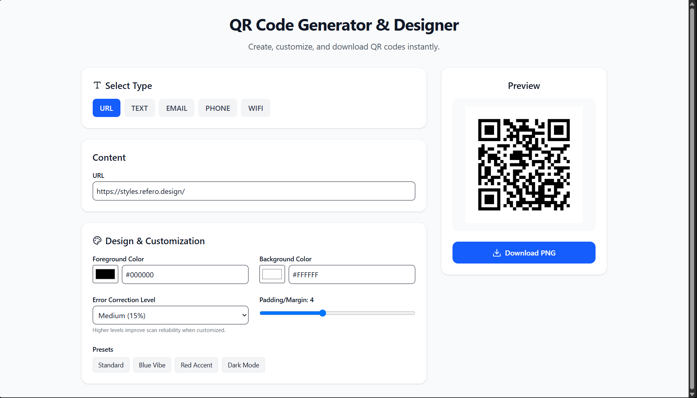
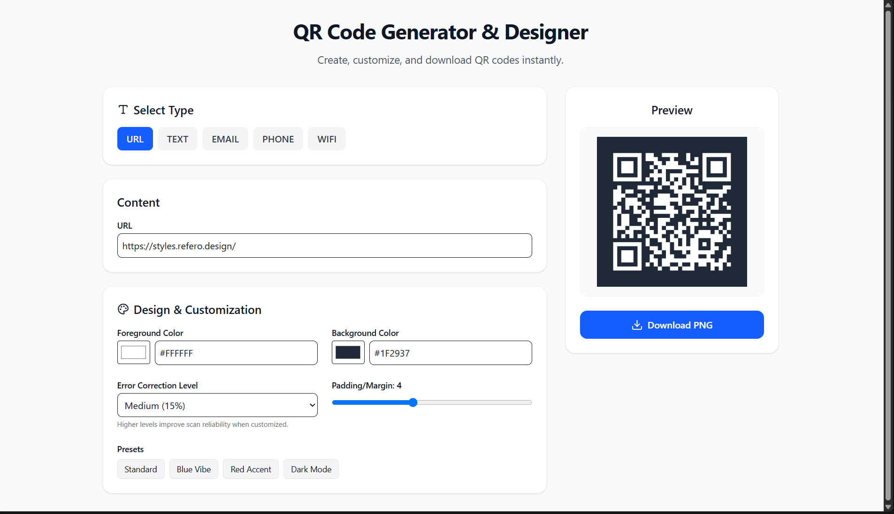

# QR Code Generator & Designer

A modern, highly customizable web application that allows users to generate and design QR codes in real-time. Built entirely in the browser using React and Tailwind CSS, without requiring any backend.

This project was built as a submission for the **GDG on Campus, SRM Recruitments 2026-27 (Technical Domain)**.

## 🚀 Live Demo
*(You can add your Vercel or Netlify link here once deployed!)*

## ✨ Features

- **Real-time Generation**: Instant QR code rendering as you type or tweak settings.
- **Multiple Data Types Supported**:
  - 🔗 URL
  - 📝 Plain Text
  - ✉️ Email (with Subject and Body formatting)
  - 📞 Phone Number
  - 📶 Wi-Fi (Automatically formatted for Android/iOS scanning)
- **Deep Customization**:
  - Choose foreground and background colors.
  - Adjust Error Correction Levels (L, M, Q, H) to maintain scan reliability.
  - Set custom padding and margins.
- **Design Presets**: Quick-select aesthetic combinations (e.g., *Blue Vibe*, *Dark Mode*).
- **History (Recent QR Codes)**: The app locally saves up to 10 of your recently generated QR codes for easy reuse even after page reloads.
- **Instant Download**: Download your customized QR code reliably as a PNG.
- **Responsive Layout**: Designed for seamless use on both mobile devices and desktop screens.

## 🛠️ Technologies Used

- **Frontend Framework**: [React 19](https://react.dev/) + [TypeScript](https://www.typescriptlang.org/)
- **Build Tool**: [Vite](https://vitejs.dev/)
- **Styling**: [Tailwind CSS v4](https://tailwindcss.com/)
- **QR Code Engine**: [qrcode.react](https://github.com/zpao/qrcode.react)
- **Icons**: [Lucide React](https://lucide.dev/)

## 💻 Getting Started Locally

To run this project on your local machine, follow these steps:

### Prerequisites
Make sure you have [Node.js](https://nodejs.org/) installed on your computer.

### Installation

1. **Clone the repository:**
   \`\`\`bash
   git clone https://github.com/your-username/your-repo-name.git
   cd your-repo-name
   \`\`\`

2. **Install dependencies:**
   \`\`\`bash
   npm install
   \`\`\`

3. **Start the development server:**
   \`\`\`bash
   npm run dev
   \`\`\`

4. Open your browser and navigate to \`http://localhost:5173\`.

## 📸 Screenshots

*(Here are the application screenshots)*

---
*Developed with ❤️ for GDG SRM Recruitments.*
